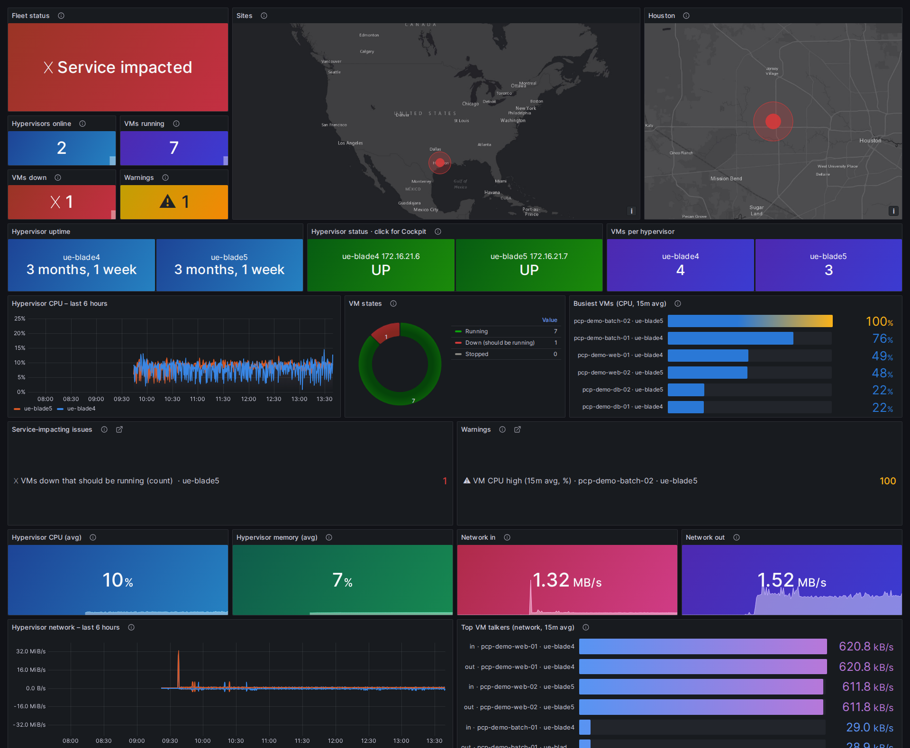
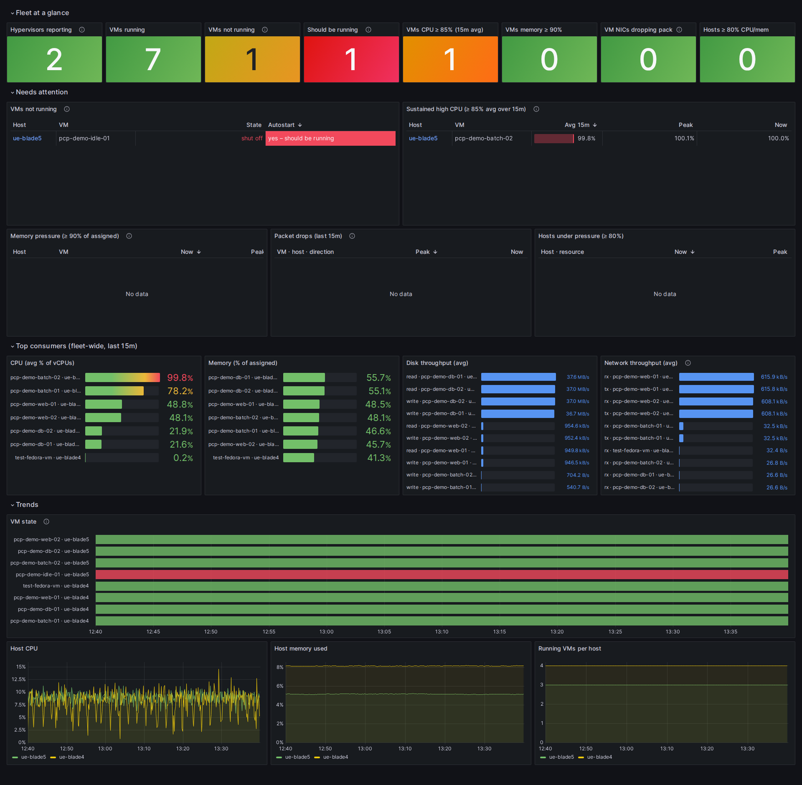
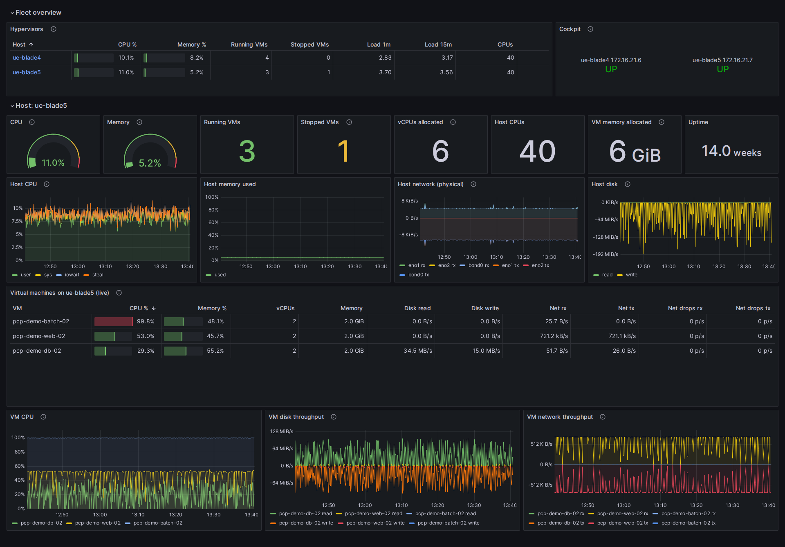

# rhel-kvm-dashboard

Fleet monitoring for RHEL KVM hypervisors with
[Performance Co-Pilot](https://pcp.io) (PCP) and Grafana, using only packages
from the RHEL AppStream repo. It works on bootc / image-mode hosts as well as
on package-mode RHEL.



Every hypervisor runs the PCP collector. One of them (the *collector*) also
logs every hypervisor centrally into Valkey and serves Grafana. Three
dashboards cover three audiences:

| Dashboard | For | What it shows |
|---|---|---|
| **Ops Status** (`/d/ops-status`) | managers, wall screens | One overall status (✓ All systems normal / ⚠ Attention needed / ✕ Service impacted), a site map plus a close-up, KPI tiles with sparklines, per-hypervisor UP/DOWN tiles that click through to **Cockpit**, a VM-state donut, the busiest VMs, plain-language issue lists, and fleet CPU/memory/network throughput. |
| **Fleet Health** (`/d/fleet-health`) | ops, triage | Every hypervisor and VM at once, with outliers brought to the top: VMs that are down (and *should* be running), sustained high CPU, memory pressure, packet drops, busy hypervisors, top consumers, and a VM state timeline. |
| **Hypervisor & VM Overview** (`/d/hv-vm-overview`) | ops, drill-down | A fleet table, then one section per selected hypervisor: CPU/memory gauges, VM counts, vCPU and memory allocation, host CPU/memory/network/disk charts, a **live** per-VM table (CPU %, memory %, disk and network rates, drops), and per-VM trends. |

The PCP-shipped dashboards (PCP Vector / PCP Redis *Host Overview*) are
provisioned too.

### Screenshots

These come from a two-hypervisor lab running demo VMs, with two problems
created on purpose: an autostart VM shut down, and a VM pinned at 100% CPU.

**Fleet Health:** outliers first. The down VM is flagged *should be running*,
the hot VM appears under sustained high CPU, and a VM state timeline sits
below.



**Hypervisor & VM Overview:** the fleet table with Cockpit links, then one
hypervisor in detail, with a live per-VM table and per-VM trends.



> This started from Red Hat's blog series
> [Visualizing system performance with RHEL 8 using PCP and Grafana](https://www.redhat.com/en/blog/visualizing-system-performance-rhel-8-using-performance-co-pilot-pcp-and-grafana-part-1)
> and extends it to many hosts, VMs and image mode. The full step-by-step
> guide, with every pitfall hit along the way, is in
> **[docs/setup.md](docs/setup.md)**.

## How it works

```
  every hypervisor                                 collector (one of the hypervisors)
 ┌───────────────────────────────┐               ┌──────────────────────────────────────────┐
 │ pmcd                          │  tcp/44321    │ pmlogger farm ──► archives (/var/log/pcp)│
 │  ├─ linux, kvm, … (stock)     │◄──────────────┤ pmproxy ──► Valkey (time series)          │
 │  ├─ pmdalibvirt   (per-VM)    │               │ grafana-server (tcp/3000)                 │
 │  └─ pmdaopenmetrics           │  tcp/44322    │   ├─ PCP Redis  → history, all hosts      │
 │      └─ libvirt_vms.python    │◄──────────────┤   └─ PCP Vector → live, per host          │
 │ pmproxy (live REST API)       │               │ pmdaopenmetrics                           │
 │ derived metrics (ops.*)       │               │   └─ pcp_hosts.python → host reachability,│
 └───────────────────────────────┘               │      map status, fleet totals (sites.json)│
                                                 └──────────────────────────────────────────┘
```

- **History:** the collector's `pmlogger` farm pulls from every
  hypervisor's `pmcd` every 10 s. `pmproxy` loads the archives into Valkey,
  and Grafana queries them with the *PCP Redis* datasource (it works with
  Valkey despite the name).
- **Live:** the *PCP Vector* datasource talks to each hypervisor's
  `pmproxy` directly. It feeds the live VM table.

### What's added on top of stock PCP

| Piece | File(s) | Why |
|---|---|---|
| **Per-VM metrics** | `pcp-pmda-libvirt` (RHEL package) | CPU, vCPU, memory/RSS, disk and network per VM, labelled with the VM name. |
| **Derived metrics** | `pcp/derived/ops-overview.conf` | Host and VM CPU/memory percentages, and stable aliases for VM counts. Computed by `pmlogger` at collection time, because **pmproxy 6.3.7 crashes on arithmetic in queries**. |
| **Logging group** | `pcp/pmlogconf/ops/overview` | A pmlogconf group that logs exactly what the dashboards need, on every host (local and farm). |
| **VM state for every domain** | `pcp/openmetrics/libvirt_vms.python` | `pmdalibvirt` only sees *running* VMs. This scripted OpenMetrics source reports the state and autostart flag of every defined VM, plus per-host totals, so "down VM" and "should be running" are real signals. It uses libvirt's Python bindings, because SELinux won't let `pmcd` run `virsh`. |
| **Hypervisor reachability and sites** | `pcp/openmetrics/pcp_hosts.python`, `pcp/openmetrics/sites.example.json` | Runs on the collector. Checks every pmlogger-farm hypervisor (an offline host is otherwise just "no data"), and exports per-host status with map coordinates and fleet-wide VM totals. Locations and management (Cockpit) addresses come from `sites.json`. |
| **tmpfiles rules** | `pcp/tmpfiles.d/` | Link the files above into `/var/lib/pcp` the way the PCP packages do, and stop the OpenMetrics PMDA scraping its sample sources (which otherwise pull Grafana's own metrics into the archives). |
| **Grafana provisioning** | `grafana/provisioning/` | The plugin, a file-based dashboard provider (folder **PCP**), and a datasource template. |
| **Dashboards** | `grafana/gen_*.py` → `grafana/dashboards/*.json` | Generated from Python, so the queries, thresholds and colours live in readable code. |

## Repository layout

```
docs/setup.md                  full guide: live layering (A) and bootc image (B), gotchas, verification
pcp/
  derived/ops-overview.conf    derived metrics           → /etc/pcp/derived/
  pmlogconf/ops/overview       pmlogconf group           → /etc/pcp/pmlogconf/ops/
  openmetrics/                 scripted sources + sites  → /etc/pcp/openmetrics/
  tmpfiles.d/                  /var/lib/pcp links        → /etc/tmpfiles.d/
grafana/
  dashlib.py                   shared panel builders, site inventory loader
  gen_dashboard.py             → Hypervisor & VM Overview
  gen_fleet_dashboard.py       → Fleet Health
  gen_status_dashboard.py      → Ops Status
  dashboards/                  built dashboards (from the example inventory)
  provisioning/                Grafana provisioning files
bootc/
  Containerfile                reference bootc image: KVM/QEMU, libvirt, Cockpit, firewalld + this monitoring stack
  pcp-pmda-install.service     first-boot unit that registers the libvirt/openmetrics PMDAs
demo/                          synthetic-load demo VMs (cloud-init) for testing
Makefile                       make dashboards / make example-dashboards
```

## bootc hypervisor image

**[`bootc/Containerfile`](bootc/Containerfile)** is a complete reference image
for an image-mode RHEL KVM hypervisor, with this monitoring stack built in:

- **Virtualization:** `qemu-kvm`, `libvirt` (modular daemons:
  `virtqemud` and friends, socket-activated), `virt-install`, `edk2-ovmf`
  for UEFI guests.
- **Cockpit:** `cockpit`, `cockpit-machines` (VM management) and
  `cockpit-pcp` (Cockpit's metrics history comes from the same PCP
  archives).
- **Monitoring:** `pcp`, `pcp-zeroconf`, `pcp-pmda-libvirt`, `grafana`,
  `grafana-pcp`, `valkey`, plus all of this repo's PCP config, the Grafana
  provisioning, and dashboards generated at build time from your
  `sites.json`.
- **Host config:** `firewalld` with Cockpit, pmcd, pmproxy and Grafana open,
  and services enabled explicitly (image builds don't run the packages'
  enablement). A first-boot unit registers the libvirt and OpenMetrics
  PMDAs, which need a running `pmcd`.

```bash
# on a subscribed RHEL host (the build uses the host's entitlement; no credentials in the file)
cp pcp/openmetrics/sites.example.json pcp/openmetrics/sites.json   # then edit
podman login registry.redhat.io
podman build -f bootc/Containerfile -t registry.example.com/rhel-kvm-image:1.0 .
```

Every hypervisor runs the same image. On the one host chosen as the
collector, turn on Valkey, Grafana and the pmlogger farm after deployment
(docs/setup.md, *B2*).

Test-built from `rhel-bootc` 9.8: `bootc container lint` passes 11 checks.
The two remaining warnings come from RHEL's own packages (libvirt's
`libvirtdbus` user, and package-created `/var` directories). A booted
deployment of this exact image hasn't been tested yet; the same
configuration is running live (Approach A).

## Quick start

The outline is below; [docs/setup.md](docs/setup.md) has every command. For
new hosts, the bootc image above does steps 1, 2 and 4 for you.

1. **Packages, on every hypervisor:** `pcp pcp-zeroconf pcp-pmda-libvirt
   grafana grafana-pcp valkey` (via `rpm-ostree install --apply-live`, `dnf`,
   or baked into your bootc image).
2. **Agents:** set `PMCD_LOCAL=0` in `/etc/sysconfig/pmcd`, turn off
   pmproxy's Valkey `[keys]`, and enable `pmcd pmlogger pmproxy`.
3. **Collector:** enable `valkey pmcd pmlogger pmproxy`, add each agent to
   `/etc/pcp/pmlogger/control.d/remote` (the pmlogger farm), and install the
   Grafana provisioning files.
4. **VM monitoring, on every hypervisor:** register the libvirt and
   OpenMetrics PMDAs, and install the `pcp/` files. Then regenerate the
   pmlogger configs on the collector.
5. **Site inventory:** copy `pcp/openmetrics/sites.example.json` to
   `sites.json`, and fill in each hypervisor's site, coordinates and
   management address.
6. **Dashboards:** run `make dashboards`, copy `build/*.json` to
   `/etc/grafana/dashboards/pcp/` on the collector, and browse to
   `http://<collector>:3000/d/ops-status`.

## Customising

- **Inventory (`pcp/openmetrics/sites.json`, git-ignored):** hypervisor name
  (as in its pmlogger archive directory), `site`, `lat`/`lon`, and the
  management `address` for Cockpit links. The collector script reads it at
  runtime. The generators use it for host order, the fixed per-host colours
  and the close-up map (the first site). The repo ships
  `sites.example.json`.
- **Thresholds:** constants at the top of `grafana/gen_fleet_dashboard.py`
  and `grafana/gen_status_dashboard.py`. Defaults: VM CPU ≥ 85% averaged
  over 15 min, VM memory ≥ 90% of assigned, any packet drop, and hypervisor
  CPU/memory ≥ 80%. Thresholds live in code because Grafana 10.2 can't use
  dashboard variables inside transformations.
- **Regenerate:** `make dashboards` builds `build/` for your inventory, and
  `make example-dashboards` rebuilds the committed copies from the example.

## Requirements and tested versions

- RHEL 9 (developed on 9.8, image mode via bootc 1.13 / rpm-ostree 2026.1),
  with libvirt/KVM.
- PCP 6.3.7, Grafana 10.2.6, grafana-pcp 5.1.1, Valkey 8.0.10 (all AppStream).
- Open ports: 44321/tcp (`pmcd`) and 44322/tcp (`pmproxy`) on hypervisors,
  and 3000/tcp (Grafana) on the collector.
- Browsers viewing Ops Status need internet access for the map tiles (Esri
  World Dark Gray Canvas). CARTO, Grafana's default basemap, now requires an
  API key.

## Notable gotchas

docs/setup.md lists twelve with fixes. The ones most likely to bite:

- **Image mode doesn't enable services from package scriptlets.** Enable
  `pmcd`, `pmlogger`, `pmproxy` and friends explicitly. In an image, add
  presets *and* symlinks.
- **`pmcd` listens on localhost only by default** (`PMCD_LOCAL=1`).
- **`rpm-ostree --apply-live` doesn't load new SELinux policy.** Run
  `load_policy` and rerun `systemd-tmpfiles --create`. A failed live apply
  also blocks later ones until you run `rpm-ostree apply-live --target <commit>`.
- **pmproxy 6.3.7 segfaults on series arithmetic** in pmseries/PCP Redis
  queries. Every query here is a plain selector; maths happens in derived
  metrics or in Grafana.
- **OpenMetrics instance labels don't reach pmseries.** The dashboards parse
  them from the instance name instead.
- **Grafana and PCP field config:** the datasource's own field config beats
  panel defaults, so value mappings go in overrides or on fields created by
  transformations.

## Design notes

- **Per-rule thresholds** (the overall status, the issue lists) use Grafana
  server-side expressions: per rule, a Reduce plus a Math threshold.
  **Fleet totals** resample every host onto a shared grid first, because
  hosts sampled a few seconds apart never line up otherwise.
- **The live VM table** uses PCP Vector's `metrics_table` format (one row
  per VM, one column per metric). A PCP Redis query can't produce that shape.
- **Colour:** status colours (good `#0ca30c`, warning `#fab219`, critical
  `#d03b3b`) appear only where they mean status, and always with an icon and
  words. Hosts get fixed categorical colours, in a set validated for colour
  vision deficiency on Grafana's dark theme.
- **Limitations:**
  - SR-IOV VF traffic bypasses the host network stack, so it's invisible to
    both host and libvirt network metrics.
  - `pcp_hosts.python` opens a connection to every hypervisor on each fetch,
    which is fine for tens of hosts but not thousands.
  - Ops Status is taller than one 1080p screen.

## Demo VMs

`demo/mkvm.sh` creates small Fedora Cloud VMs whose cloud-init installs a
`cpu`, `disk`, `net` or `idle` synthetic workload (`demo/demo-load.sh`), to
populate the dashboards. docs/setup.md also shows how to create a "down" VM
and a "hot" VM on purpose to exercise the outlier views.

## License

GPL-2.0. See [LICENSE](LICENSE).
